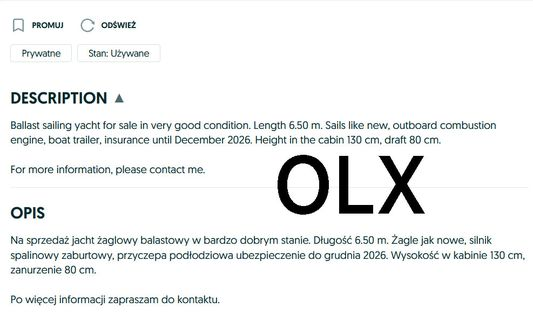
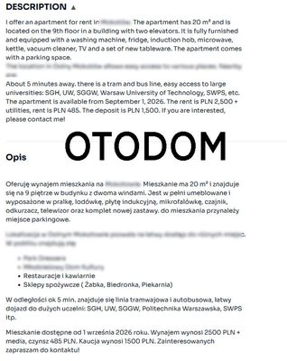
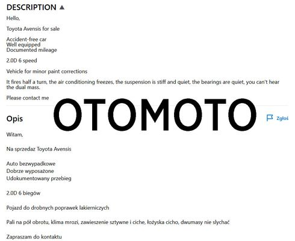

<div align="center">

  

  # Podil Translator

  **Automatic Browser Extension for Translating OLX, Otodom, and Otomoto Listings.**

  [](LICENSE)
  [](manifest.json)
  [](#installation)

</div>

---

## 📌 Overview

**Podil Translator** is a lightweight, open-source browser extension designed to eliminate language barriers when searching for real estate, cars, or second-hand items in Poland.

It automatically detects listing descriptions on **OLX.pl**, **Otodom.pl**, and **Otomoto.pl** and translates Polish text into your chosen language directly on the page without disrupting layout or design.

---

## ✨ Features

- ⚡ **Automated In-Page Translation:** Instantly converts Polish listing descriptions into your preferred language right above the original text.
- 🌐 **Multi-Language Support:** Select from 30+ supported languages from the extension popup.
- 🧩 **Interactive Popup Menu:** Easily choose your target language with auto-save.
- 🔄 **Next.js & React SPA Navigation:** Seamlessly tracks client-side route changes, ensuring newly opened listings are immediately translated without full page reloads.
- 🛡️ **CSP & CORS Resilient:** Uses background service scripts to communicate with translation services, avoiding website Content Security Policy (CSP) and CORS blocking.
- ✂️ **Smart Text Chunking:** Intelligently splits long listings (4,000+ characters) into safe query chunks respecting paragraph and sentence boundaries, avoiding HTTP GET URL length limits (~2000 chars).
- 🔒 **Privacy Focused:** Minimal permissions requested.

---

## 📸 Screenshots & Previews

<div align="center">

### 1. OLX.pl Integration


### 2. Otodom.pl Integration


### 3. Otomoto.pl Integration


</div>

---

## 🚀 Installation

### 🛍️ Web Stores
* **Mozilla Firefox Add-ons:** [Get Podil Translator](https://addons.mozilla.org/en-US/firefox/addon/podil-translator/)
* **Opera Add-ons:** ⏳ *Coming Soon*

---

### 🔧 Manual Installation (Developer Mode)

1. Clone or download this repository:
   ```bash
   git clone https://github.com/AenR/podil-translator.git
   ```

2. Open chrome://extensions/ or about:debugging in your browser.

3. Enable Developer Mode and load the project folder using Load unpacked / Load Temporary Add-on.

---

## 🤝 Contributing

Contributions, issues, and feature requests are welcome!

- **GitHub Repository:** [https://github.com/AenR/podil-translator](https://github.com/AenR/podil-translator)
- Feel free to check the [issues page](https://github.com/AenR/podil-translator/issues) or submit a Pull Request.

---

## 📄 License

This project is licensed under the [MIT License](LICENSE).
